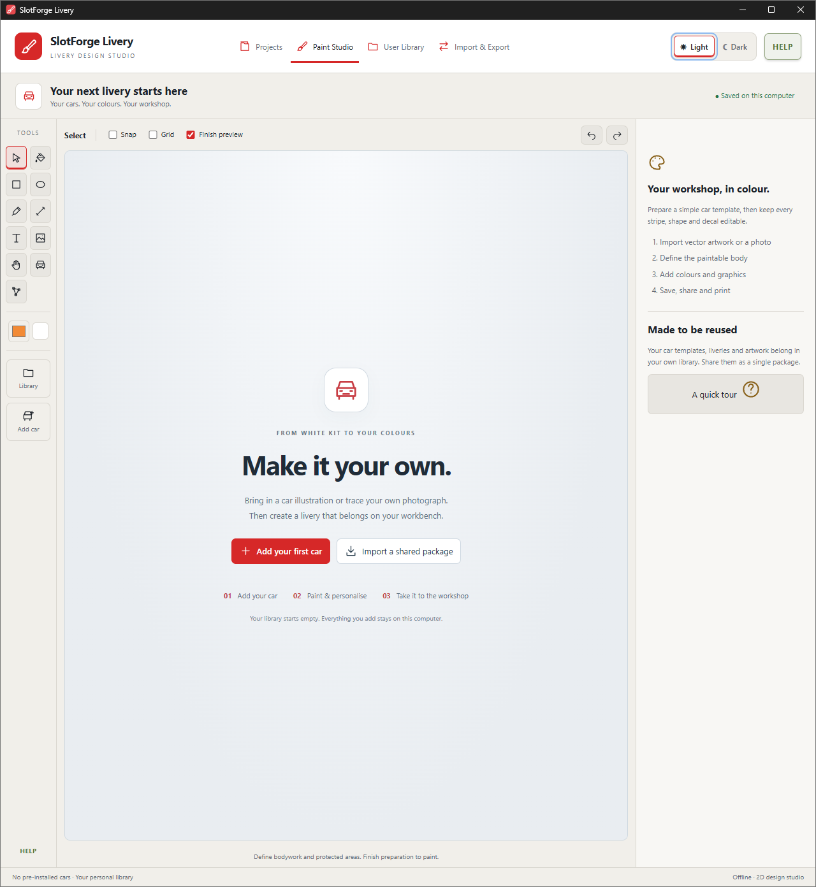
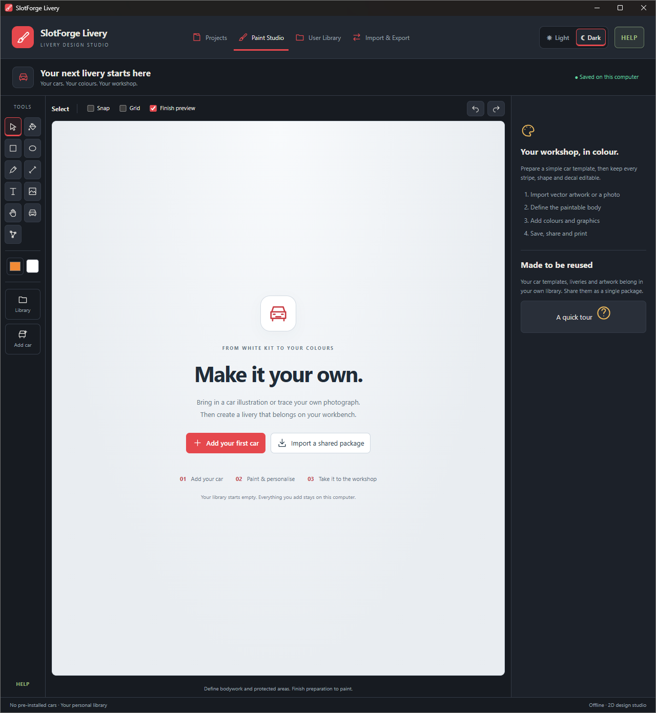

  
  

 

# SlotForge Livery

**From White Kits to your Design Concept**

SlotForge Livery is a desktop design studio for planning how to paint and decorate your slotcars. Import your own car artwork, click the panels you want to paint, and build a livery with colours, gradients, racing stripes, numbers and decals. Keep the design editable, share it with another builder, or print a reference for your workshop.

**Your cars, your designs, your library.** Livery works offline on Windows, macOS and Linux, without an account. You bring the car templates; there is no preinstalled catalogue to limit what you can work on.

[Download Livery](https://github.com/theDutchmanJames/SlotForgeLivery/releases/latest) · [See the app](#pictures-of-the-app) · [Explore the features](#features-and-functionality) · [How to install](#how-to-install) · [Report a problem](#reporting-problems)

## SlotForge App Collection

SlotForge Livery is part of the **SlotForge App Collection**—apps for building tracks, managing your cars, designing their appearance and exploring their performance.

-  **[SlotForge Timing](https://github.com/theDutchmanJames/SlotForgeTiming)** — Time laps, manage races and create custom race displays for analogue slotcar tracks.
-  **[SlotForge Paddock](https://github.com/theDutchmanJames/SlotForgePaddock)** — Organize your slotcar collection, photographs, parts, setups and maintenance in a virtual garage and workshop.
-  **[SlotForge Telemetry](https://github.com/theDutchmanJames/SlotForgeTelemetry)** — Explore gearing, motors, tyres and weight, compare setups, and analyse recorded lap times.
-  **[SlotForge Decals](https://github.com/theDutchmanJames/SlotForgeDecals)** — Size and arrange artwork into decal sheets, then export a PDF for printing.
-  **[SlotForge Circuit](https://github.com/theDutchmanJames/SlotForgeCircuit)** — Design slotcar tracks, including routed and FreeForm layouts, and export track data for Timing's Live Tracker.

Visit each app's repository for its features, downloads and getting-started guide. Circuit was previously called SlotForge Track Builder; its repository is now SlotForgeCircuit.

## Pictures of the app

<table>
  <tr><th width="50%">Paint Studio · light theme</th><th width="50%">Paint Studio · dark theme</th></tr>
  <tr>
    <td></td>
    <td></td>
  </tr>
</table>

*An example design in the editor. Car artwork is supplied by the user, not included as a built-in template. Click any screenshot for a closer look.*

  
<strong>Your starting workspace · light and dark</strong>

<table>
  <tr><th width="50%">Light workspace</th><th width="50%">Dark workspace</th></tr>
  <tr>
    <td></td>
    <td></td>
  </tr>
</table>

## Features and functionality

### Bring your own cars

**Vector import is at the heart of Livery.** Open supported **SVG, EPS or vector PDF** artwork and turn it into a reusable car template. EPS and PDF conversion is included in the desktop app and works offline, without installing a separate converter. For a multi-page PDF, choose the page you want to use.

Each project has six independent view slots: **front, top, left, right, rear and angled**. Add only the views you need, then replace or remove them as the project develops. Preparing one view does not generate the other sides of the car.

You can also import a **PNG, JPEG or WebP photograph** and trace its paintable areas manually. Save a prepared template in your library to start future liveries without repeating the preparation.

### Click the panels you want to paint

**Select a few areas, give them a label, and start painting.** The preparation workspace lets you click enclosed areas or drag a selection box, then label them together as Bodywork, Windows, Lights, Wheels, Tyres, Trim, Interior or Chassis.

Labelling makes the selected areas paintable. In the editor, choose a whole label group or individual areas within it to give different parts their own appearance. Use **Reference only** for details you want to preserve without painting over them.

- **Recover paintable areas:** turn enclosed spaces in line artwork into panels, including white bodywork that was drawn as empty space rather than a separate filled shape.
- **Add filtered areas:** recover small details excluded when a complex illustration is simplified for preparation.
- **Trace missing areas:** draw an outline manually when an area is open or cannot be recovered automatically.
- **Refine later:** return to **Edit areas & labels** whenever you need to change the preparation.

Vector objects do not all have to become editable layers. **Generate all vector regions** is an optional tool for assigning Body, Protect, Detail or Hide roles when you need more control over the source artwork.

### Paint colours, gradients and finishes

Try a base colour for the car, then give selected panels their own paint. Choose **Solid** or **Gradient** fills; gradients support **2–8 colour stops**, with controls for their positions, direction and strength.

Combine **Matte, Satin or Gloss** finishes with **Solid, Metallic or Pearl** effects. Optional finish previews add subtle visual cues on the canvas so you can explore the intended look. Toggle **Finish preview** above the canvas whenever you want to see the colours without those cues.

These are design references, not a physical paint simulation. Add your paint product references and workshop notes to record what you intend to use on the real car.

### Draw shapes, curves and racing stripes

The compact toolbox keeps the canvas open for designing. **Choose a shape tool and draw: its layer is created automatically.**

- Draw **rectangles, ellipses and freeform shapes** for colour blocks, roundels and graphics.
- Click to place a corner, or press and drag to create **Bézier handles** for a smooth curve.
- Close a shape by snapping back to its first point. Use **Edit Points** to adjust anchors and curve handles afterwards.
- Draw **open curved lines** for stripes and pinstripes, with adjustable thickness and flat or rounded ends.
- Start with **single, double or triple stripes**, or combine different widths, gaps and colours—for example, a broad centre stripe with two fine outer lines.

Lines remain editable paths. Finish one with **Enter**, **Escape**, right-click or **Finish line**; use **Cancel** to discard the unfinished line.

### Add decals, lettering and your own fonts

Import your graphics as images and position them on the car. **PNG transparency is preserved**, so a logo or decal can sit on the bodywork without a rectangular background.

Add text and race numbers, choose a typeface, and adjust their colour, size and placement. Import **TTF, OTF, WOFF or WOFF2** fonts into Livery's library without installing them system-wide. Custom fonts used by shared designs can travel with the package.

### Fit artwork and work in layers

Position, resize and rotate shapes, text and decals. For an angled car view, use **skew, compression and pinch** to make artwork follow the apparent direction of a panel. Presets provide starting angles; fine controls let you adjust the result. Pinching one end makes it appear to recede into the distance.

The layer list keeps the design organised:

- Drag layers to reorder them, or use the buttons to bring artwork forward and send it back.
- Select several shapes or paintable areas and change their appearance together.
- Group artwork while keeping its individual elements editable; expand the group to work on a child element.
- Use **Copy Appearance** and **Paste Appearance** to reuse compatible styling on other layers.
- Open or collapse the property folders to reach the controls you need.

Livery is a **2D editor**. Fitting controls help match a drawing's perspective; they do not create a 3D model or automatically wrap a design across different views.

### Build a library you can reuse

Keep prepared car templates, saved liveries, uploaded images, fonts and reusable artwork in **User Library**. Search and sort your items, rename them and edit their details.

Shapes stay in the project until you choose **Add to Library**. Select several shapes to save an editable group; each element keeps its own properties for later changes.

Apply a saved livery to another car as a starting point. Check its placement in each view and adjust it to suit the new bodywork—different car shapes still need your judgement.

### Share editable designs with other builders

**Share the design itself, not just a picture of it.** Open **Import & Export → Export a package**, choose the library items you want to share, and save a **`.sfpaint` package**. Another Livery user opens **Import a package** to add it to their library.

Packages can contain selected templates, liveries, shapes, images, fonts or complete projects. A project includes its car template and embedded artwork; grouped shapes retain their separate editable elements. Imports add independent copies instead of overwriting existing items.

Prepare a car, design a livery, export both, and let a friend make their own version. Share only artwork and fonts you have permission to redistribute: a package can contain the original embedded files.

### Export for the workshop or to show your design

| Export | What you get |
| --- | --- |
| **Workshop PDF** | Design views, paint references and notes to print and take to your workbench. Gradient colours are included; the preview sheen is left out. |
| **Transparent PNG** | A cropped, freestanding image of a chosen car view, without the canvas background. Choose an output size from 1,000 to 4,000 pixels and whether to include the finish preview. |
| **Editable package** | Selected library items or a complete project that another Livery user can continue editing. |
| **Whole-library backup** | A portable copy of your library for recovery or moving to another computer. |

The PDF is a **visual painting reference**, not a calibrated decal sheet, cutting template or colour proof. Use SlotForge Decals when you need to arrange artwork at printed dimensions on decal paper.

### Make the workspace comfortable

Choose from **eight SlotForge themes**, or create a custom palette in **Settings**. Set your background, panel, text, border and accent colours, preview the result, then save or cancel. Interface themes do not change your car's paint or exported designs.

Use pan, zoom, Snap, Grid and undo/redo while editing. Click empty canvas to clear the selection and look at the design without selection boxes. **HELP** explains the tools and shortcuts inside the app.

| Action | Control |
| --- | --- |
| Pan | Hand tool, middle mouse drag, or Ctrl + left drag |
| Zoom | Mouse wheel or zoom buttons; **Fit** restores the overview |
| Select several paintable areas | Shift-click on the canvas; Shift-click or Ctrl-click in Layers |
| Select several artwork layers | Shift-click shapes; Shift-click or Ctrl-click their Layers rows |
| Clear selection | Click empty canvas, or Escape when not drawing |
| Draw a corner / curve | Click / press and drag |
| Close a freeform shape | Click near its first point, or press Enter |
| Finish an open line | Enter, Escape or right-click |

### Supported files and artwork preparation

| Purpose | Formats |
| --- | --- |
| Vector car artwork | SVG, EPS, PDF |
| Photographs and image decals | PNG, JPEG, WebP |
| Custom fonts | TTF, OTF, WOFF, WOFF2 |
| Design exports | PDF, PNG |
| Editable exchange and backups | `.sfpaint` |

Use flat vector artwork with clear enclosed panels for the easiest preparation. Expand unsupported effects and symbols, and convert text in imported car illustrations to outlines. Embedded scripts and external resources are excluded. EPS/PDF artwork with shading, bitmap content or password protection needs preparation in another editor.

Photographs require manual tracing; there is no automatic photo-to-vector conversion or recognition of unseen car surfaces. Detailed illustrations may have small areas filtered out, with manual recovery available.

Import limits are **5 MB for SVG**, **25 MB for EPS/PDF**, **10 MB per image or font**, and **180 MB per package**. Large libraries with many embedded images can use substantial memory and storage.

### Local storage and backups

Your projects and library are stored on your computer in SQLite. Livery saves changed objects independently, reuses identical media, and loads library artwork when you need it. Use **Import & Export** to keep separate backups; packages remain limited to 180 MB, so larger collections should be exported in selections.

Existing JSON libraries migrate automatically after verification, with the original files preserved. After migration, use the updated app: older executables still read the original, now-outdated JSON. See [library storage and recovery](docs/SQLITE-STORAGE.md) for details.

The data folder retains its original **SlotForge Paintshop** name for compatibility:

- Windows: `%APPDATA%\SlotForge Paintshop`
- macOS: `~/Library/Application Support/SlotForge Paintshop`
- Linux: `$XDG_CONFIG_HOME/SlotForge Paintshop`, normally `~/.config/SlotForge Paintshop`

Use export/import to move your library, rather than editing its storage files by hand.

## How to install

Open the **[latest GitHub release](https://github.com/theDutchmanJames/SlotForgeLivery/releases/latest)** and expand **Assets** to see the downloads. Choose the packaged app for your computer. **You do not need Node.js, Git, a terminal or programming experience.** GitHub's **Source code** ZIP and tar.gz files are for building the app yourself.

| Your computer | Download | Open or install |
| --- | --- | --- |
| **Windows · Intel/AMD 64-bit** | `SlotForgeLivery-…-windows-x64.exe` | Save the portable executable in a folder you want to keep, then double-click it. |
| **Mac · Apple silicon (M1 or newer)** | `…-mac-arm64.dmg` | Open the disk image and drag Livery into **Applications**. |
| **Mac · Intel** | `…-mac-x64.dmg` | Open the disk image and drag Livery into **Applications**. |
| **Ubuntu/Debian · Intel/AMD 64-bit** | `…-linux-amd64.deb` | Open with your software installer, choose **Install**, then launch Livery from the applications menu. |
| **Other compatible Linux · Intel/AMD 64-bit** | `…-linux-x86_64.AppImage` | Save it, allow running it as a program in **Properties → Permissions**, then double-click it. |
| **Linux · ARM64** | `…-linux-arm64.deb` or `…-linux-arm64.AppImage` | Follow the matching Debian or AppImage instructions above. |

On a Mac, **Apple menu → About This Mac** identifies the chip or processor. Mac ZIP downloads are also available: extract the app and move it to Applications. After installing from a DMG, you can eject the disk image.

Windows downloads are unsigned. Mac downloads are ad-hoc signed, not Apple-notarised. Your operating system may ask you to approve the app; verify that it came from this repository. On macOS, a per-app approval may be available in **System Settings → Privacy & Security** after you try opening it. SHA-256 manifests accompany release downloads for integrity checks.

AppImage permission labels vary between Linux desktops. Some distributions need a FUSE compatibility package; the Debian package is an alternative on supported systems. If the app still will not open, report the error instead of running it as root or disabling its sandbox.

### Your first livery

1. Choose **Add car**, name the car and select a view.
2. Import vector artwork, or choose a photograph and trace the areas you need.
3. In **Prepare areas & labels**, select panels, choose **Label** and assign a car-part label. Repeat for other groups; use **Reference only** for parts you want to leave unchanged.
4. Save preparation. Select a label group or an individual area in **Layers**, then choose its colour, gradient and finish.
5. Draw stripes and shapes, add race numbers and place your decals. Adjust fitting for angled views.
6. Save the livery for reuse, export a workshop PDF, or share it as an editable package.

**Start with the bodywork**, try a base colour, then prepare windows, wheels and trim as separate groups. You can return to **Edit areas & labels** later.

### Updating and moving to another computer

Export a whole-library backup, close Livery, then open the new portable executable or install the newer package. Your library is stored separately from the application. Replacing the executable does not move your designs; use the exported backup to transfer them to another computer. Keep backups outside the app folder.

### Run or build from source

For developer setup, native build scripts and converter requirements, see **[Building SlotForge Livery](docs/BUILDING.md)**. The build guide includes Windows, macOS and Linux instructions. [Verification notes](TESTING.md) describe the automated checks.

## Reporting problems

Open an **[issue on GitHub](https://github.com/theDutchmanJames/SlotForgeLivery/issues)** and include:

- Your Livery version, operating system and the download you used.
- What you were doing, what you expected and what happened instead.
- Steps to reproduce the problem, the exact error and a screenshot if useful.
- For import problems: the file format, file size, selected PDF page where relevant, and a small example you have permission to share.
- For slow editing: which action is slow—panning, zooming, moving artwork or changing paint—and whether it affects one project or all projects.

Avoid posting a complete private library. A minimal example with personal or restricted artwork removed is more useful for investigating the problem. Feature suggestions are welcome: describe what you want to make or which step could be easier.

## License and copyright

Copyright © 2026 **theDutchmanJames and contributors**. SlotForge Livery is free and open source under the **[GNU Affero General Public License, version 3 or later](LICENSE)**.

Livery uses the AGPL rather than the source-available no-selling licence used by other SlotForge apps. Commercial redistribution is permitted subject to the AGPL's requirements. Your own original liveries and outputs remain yours; rights in third-party artwork and fonts remain separate.

The app is provided without warranty; see the [full licence](LICENSE) and [copyright notice](NOTICE). Electron, Ghostscript, MuPDF and other dependencies retain their [own licences and notices](THIRD-PARTY-NOTICES.txt). Release downloads include the corresponding application and converter sources, with [build instructions](docs/BUILDING.md).
