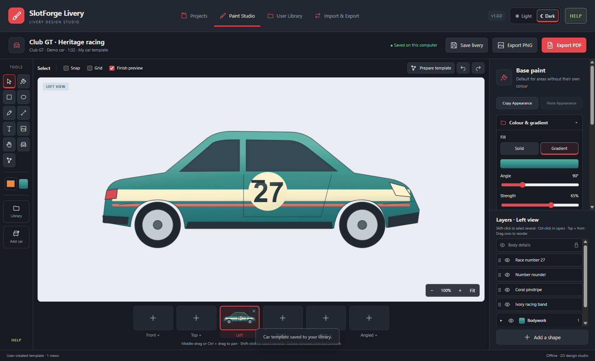
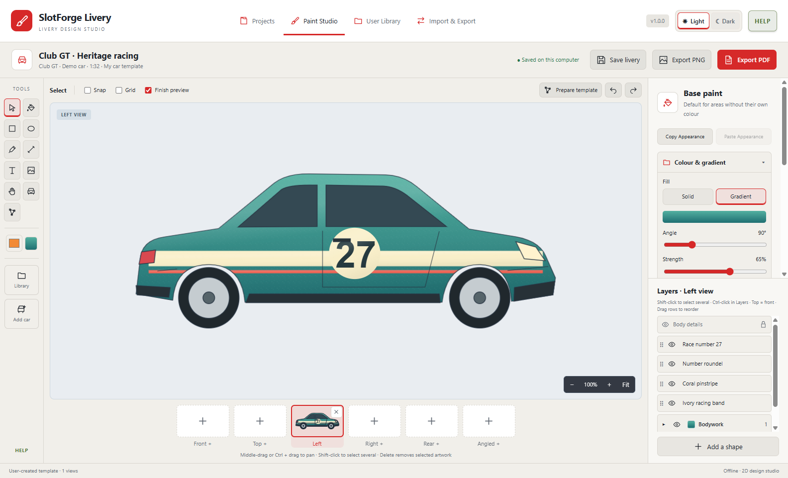

<h1 align="center">SlotForge Livery</h1>

<strong>Your car. Your colours. Your next livery.</strong> A 2D design studio for planning the paintwork on your slotcar.

  <a href="https://github.com/theDutchmanJames/SlotForgeLivery/releases">Downloads</a> ·
  <a href="#your-first-livery">Getting started</a> ·
  <a href="#what-you-can-do">Features</a> ·
  <a href="#sharing-and-backups">Sharing</a> ·
  <a href="https://github.com/theDutchmanJames/SlotForgeLivery/issues">Report an issue</a>

Bring in your own car artwork, choose the panels you want to paint, and experiment with colours, racing stripes, numbers and decals before opening a tin of paint. Save the design, share reusable artwork with another Livery user, or print a workshop reference to take to your workbench.

Livery works locally on your computer. No account, subscription or cloud library is needed. **The car library starts empty:** you create your own templates, so you are never limited to a maintained catalogue of supported kits.

<table>
  <tr><th>Dark studio</th><th>Light studio</th></tr>
  <tr>
    <td></td>
    <td></td>
  </tr>
</table>

*Actual application screenshots with original demonstration artwork. This car is not preinstalled.*

## What you can do

| From an idea… | …to a workshop-ready design |
| --- | --- |
| **Bring your own car** | Import vector artwork or trace a photograph. Add front, top, left, right, rear and angled views independently. |
| **Choose what gets painted** | Click enclosed panels, select several at once, and label them as Bodywork, Windows, Lights, Wheels, Tyres, Trim, Interior or Chassis. Labelling makes an area paintable; Reference only excludes it. |
| **Recover missing panels** | Recover enclosed areas from line artwork. Complex drawings are filtered to keep preparation manageable; **Add filtered areas** brings back details you want to include. Trace open outlines manually. |
| **Explore colour and finish** | Solid colours or gradients with 2–8 colour stops, angle and strength controls. Matte, satin and gloss finishes, plus metallic and pearl effects, include a light visual preview. |
| **Draw the livery** | Rectangles, ellipses and freeform shapes with Bézier handles. Draw open curved lines with adjustable width, double or triple stripes, and custom line combinations. |
| **Add the finishing touches** | Transparent PNG decals, text, race numbers and your own fonts. Adjust size, rotation, opacity, skew and pinch, with presets to help fit an angled view. |
| **Work with layers** | Drag layers to reorder artwork, or use front/back buttons. Group elements without flattening them, edit individual children, and copy/paste appearance settings. |
| **Edit together** | Select several paintable areas or artwork layers and change their appearance together. Each part remains independently editable. |
| **Build your own library** | Save cars, liveries, images and editable shapes or groups. Shapes enter the library when you choose **Add to Library**. Edit names and other details later. |
| **Reuse and share** | Apply a saved livery to another car, or export selected library items in a self-contained package another Livery user can import. |
| **Take it to the workshop** | Export a PDF with views and notes, or save a freestanding transparent PNG of your car. |
| **Make yourself comfortable** | Light and dark themes, collapsible property folders, zoom, canvas panning and undo/redo. |

## Install and open Livery

You do **not** need Node.js, Git, a terminal or programming experience to use a released installer.

1. Open [Releases](https://github.com/theDutchmanJames/SlotForgeLivery/releases).
2. Choose the newest release and expand **Assets** if the download list is hidden.
3. Download the file for your computer using the guide below. **Source code (zip)** and **Source code (tar.gz)** are for developers; they are not the app.

| Your computer | Download |
| --- | --- |
| Windows, Intel or AMD 64-bit | The Windows `.exe` |
| Mac with Apple silicon (M1 or newer) | The macOS `arm64.dmg`, or `universal.dmg` if offered |
| Mac with an Intel processor | The macOS `x64.dmg`, or `universal.dmg` if offered |
| Ubuntu/Debian Linux, Intel or AMD | The Linux `amd64.deb`, or `x86_64.AppImage` |
| Other Linux, Intel or AMD | The Linux `x86_64.AppImage` |
| Linux on ARM64 | The Linux `arm64` package, if offered |

### Windows

Download the Windows executable and open it. Follow any installer prompts shown by that release. For a portable release, place it in a folder you want to keep and run it there. If a release provides a ZIP instead, right-click it, choose **Extract All**, then open the Livery executable inside the extracted folder.

Unsigned builds may show an unknown-publisher warning. Check that you downloaded from this repository and that the filename matches the release before deciding to open it. A warning does not establish that a download is safe.

### macOS

Open the `.dmg`, drag **SlotForge Livery** into **Applications**, then open it from Applications. You can eject the disk image afterwards. Choose the architecture matching your Mac; **Apple menu → About This Mac** shows its chip or processor.

An unsigned or unnotarised release may be blocked by macOS. After checking its origin, use the per-app approval in **System Settings → Privacy & Security**, if macOS offers it. Do not disable system-wide security protections. Signing status will be stated in the release notes.

### Linux

On Ubuntu or Debian, open the `.deb` with your software installer and choose **Install**, then launch Livery from the applications menu.

For an AppImage, save it in a permanent folder. Right-click it, open **Properties → Permissions**, enable running it as a program, and double-click it. Names vary between desktop environments. Some distributions need an additional FUSE compatibility package; the `.deb` is an alternative on supported Debian-based systems. Do not run Livery as root or disable its sandbox to bypass a launch error.

### Updating

Close Livery and install the newer release, or replace the old portable executable. Your library lives in your user profile, separately from the application. Export a backup before updating. Keep the backup somewhere outside the app folder.

## Your first livery

1. Choose **Add car**, name your car, and choose a view.
2. Import your vector drawing, or choose a photograph and trace the areas you need. Each view has its own artwork; Livery does not invent unseen sides of the car.
3. In **Prepare areas & labels**, click the panels you want, choose **Label**, and assign a car-part label. Repeat for the next group. Use **Reference only** for parts you want to leave unchanged.
4. Save preparation. Select a label group or an individual area in **Layers**, then choose its colour, gradient and finish.
5. Add stripes, shapes, numbers or your own decals. Shape tools create their layers when you draw. Use the position and fitting controls for angled artwork.
6. Save the livery for reuse. Choose **Export PDF** for a workshop reference, or export a transparent PNG to show your design.

**A useful starting point:** prepare the bodywork first, try a base colour, then add windows, wheels and trim as separate labelled groups. Return to **Edit areas & labels** whenever you need to.

### Canvas controls

| Action | Control |
| --- | --- |
| Pan | Hand tool, middle mouse drag, or Ctrl + left drag |
| Zoom | Mouse wheel or zoom buttons; **Fit** restores the overview |
| Select several paintable areas | Shift-click on the canvas; Shift-click or Ctrl-click in Layers |
| Select several shapes | Shift-click or Ctrl-click their Layers rows |
| Clear selection | Click empty canvas or press Escape |
| Draw a corner | Click with the freeform shape or line tool |
| Draw a curve | Press and drag to pull out Bézier handles |
| Close a shape | Click near its first point, or press Enter |
| Finish an open line | Press Enter, Escape or right-click |

## Sharing and backups

Open **Import & Export → Export a package**, choose the library items you want to share, and save the `.sfpaint` file. Send that file using your usual file-sharing method. The recipient opens Livery and chooses **Import a package**.

Packages preserve editable shapes and group elements. Projects include their car template and embedded artwork. Imports create independent copies instead of overwriting existing items. A saved livery can be applied to another car, but check its placement in every view and adjust it to the new body.

For a backup, use the whole-library export. Livery also autosaves locally and retains the previous successful storage file, but that is not a substitute for a separate backup.

Only share images, fonts and car artwork you have permission to redistribute. A package can contain the original embedded assets, including photographs and custom fonts.

## Formats and practical limits

| Purpose | Supported formats |
| --- | --- |
| Vector car artwork | SVG, EPS, PDF |
| Reference pictures and decals | PNG, JPEG, WebP; PNG transparency is preserved |
| Custom fonts | TTF, OTF, WOFF, WOFF2 |
| Workshop export | PDF |
| Transparent artwork export | PNG |
| Library and project exchange | `.sfpaint` |

- This is a **2D design tool**. Skew and pinch help place artwork on angled drawings; they do not create a 3D model or automatically map between views.
- Photographs use manual tracing. There is no automatic car recognition or AI photo-to-vector conversion.
- SVG imports support ordinary vector shapes and groups. Expand unsupported effects and symbols, and convert text to outlines for predictable results. Embedded scripts and external resources are excluded.
- EPS/PDF conversion expects flat vector artwork. Password-protected PDFs, bitmap content and shading need preparation in another editor. For multi-page documents, choose one page per car view.
- Preparation filters complex illustrations, with manual recovery available. The active-area limit keeps editing manageable.
- Material previews are visual guides, not a simulation of real paint. A screen, printer and painted shell can show different colours.
- The PDF is a visual workshop reference, **not a calibrated decal sheet, cutting template or colour proof**.
- Current import limits: SVG 5 MB, EPS/PDF 25 MB, images/fonts 10 MB, packages 180 MB. Very large embedded-image libraries can use substantial memory and storage.

## Your data stays with you

Projects and the library are saved on your computer. The storage directory keeps its original **SlotForge Paintshop** name so users of earlier previews keep their data:

- Windows: `%APPDATA%\SlotForge Paintshop`
- macOS: `~/Library/Application Support/SlotForge Paintshop`
- Linux: `$XDG_CONFIG_HOME/SlotForge Paintshop`, normally `~/.config/SlotForge Paintshop`

Use the app's export controls for portable backups rather than editing the storage JSON by hand.

## Part of the SlotForge family

Livery follows the SlotForge visual language: compact tools, clear panels, familiar accents and a practical workshop focus. It joins **Timing**, **Paddock**, **Telemetry** and **Circuit**. Explore the family on [theDutchmanJames's GitHub page](https://github.com/theDutchmanJames).

## Development

See [BUILDING.md](docs/BUILDING.md) for developer setup, native build scripts, tests and corresponding converter sources. GitHub Actions builds and launch-tests each platform before publishing. [Verification notes](TESTING.md) and [preview history](docs/preview-history.md) document earlier development.

## Licence

Livery is free and open source under the [GNU Affero General Public License, version 3 or later](LICENSE). This differs from the source-available no-selling licence used by other SlotForge apps. It permits commercial redistribution subject to AGPL requirements. Your own original liveries and outputs remain yours; third-party image and font rights remain separate.

Release downloads include the corresponding application and converter sources. See [third-party notices](THIRD-PARTY-NOTICES.txt) and [build instructions](docs/BUILDING.md).
